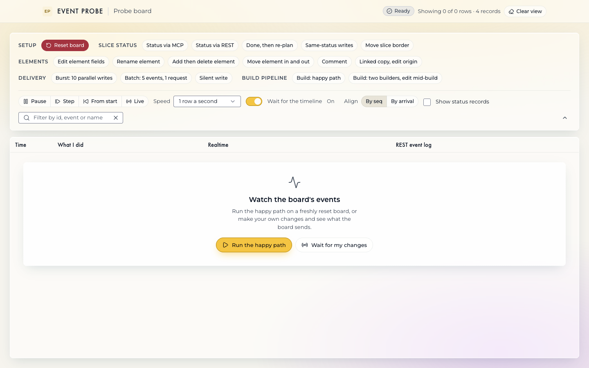
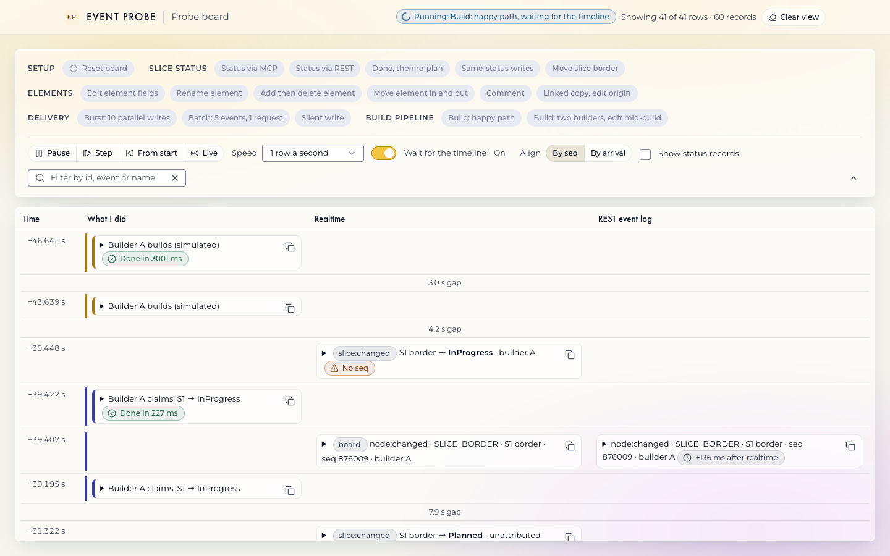
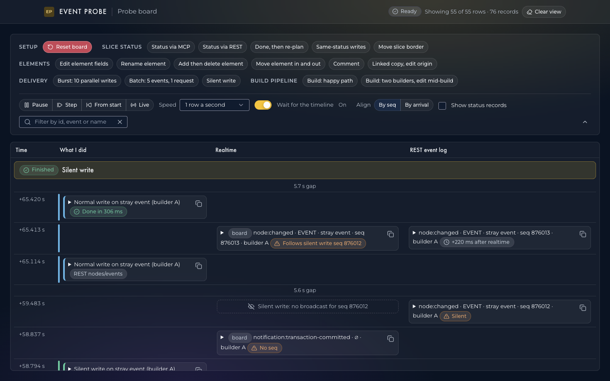
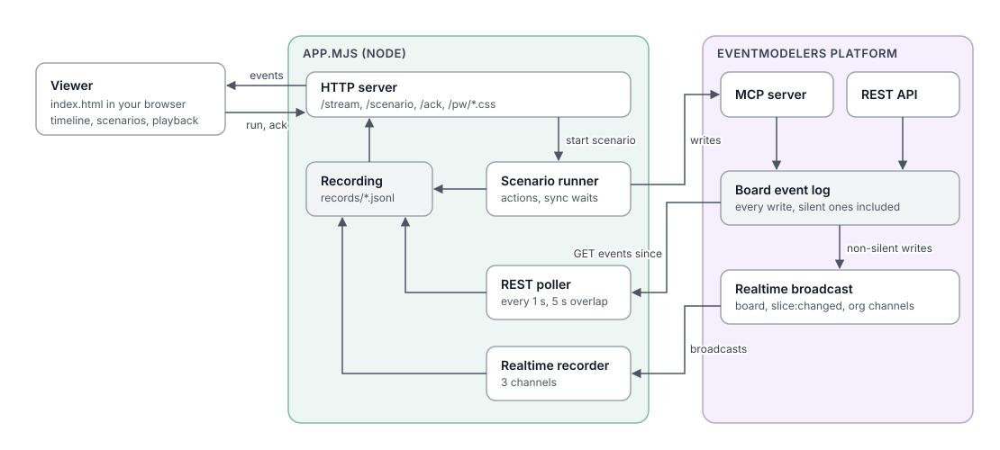

# em-event-probe

Records everything an [Eventmodelers](https://eventmodelers.ai) board emits and drives that board through scripted scenarios, so you can watch each change and the events it causes side by side.

It exists to answer one question with evidence rather than documentation: when something changes on a board, which events arrive, on which channel, in what order, and with what data? The answer shapes any system that reacts to a board, such as a pipeline that builds slices when they are planned.



## What you see

The timeline has three columns, newest event first:

- **What I did**: every change the app makes to the board. A coloured stripe runs down through the events each change caused.
- **Realtime**: what arrived on the board's realtime channels.
- **REST event log**: what the board's event log contains, polled every second.

A broadcast and its REST log entry share a row, with the delay between them. A dashed placeholder marks a write that was never broadcast.





## How it works



- **Scenario runner** changes the board, through the MCP server for the things a person would do and through REST with an agent id for builder writes. It logs each step as an action.
- **Realtime recorder** subscribes to the board's three realtime channels: `board:<id>`, `board:<id>-slicechanged` and `org:<org-id>`.
- **REST poller** reads the board's event log every second, including silent writes, and re-reads the last 5 s so a late-numbered event is not missed.
- Everything goes into one recording, a JSON-lines file in `records/`, which the server streams to the viewer.
- Your API token stays in the server. The browser never sees it.

## Requirements

- **Node 24** with npm 11 (tested). Older npm fails behind some proxies.
- **Read access to the private `@precision-weave/ui` package**, which styles the viewer. You need a GitHub token with `read:packages` in `NODE_AUTH_TOKEN`, and this line in `~/.npmrc`:
  ```
  //npm.pkg.github.com/:_authToken=${NODE_AUTH_TOKEN}
  ```
  The registry line is already in this repo's `.npmrc`.
- **An Eventmodelers board you can wipe.** Reset board, and "Run the happy path" on the first-use panel, delete every timeline on the board. Use a board made for this, never one with real work on it.
- **An Eventmodelers API token** for the board's organisation, and the board's connection object from EM Studio.
- [just](https://github.com/casey/just) (optional, for the shortcuts below).

## Install

```sh
cd em-event-probe
just install        # or: npm install
```

## Configure

Create `config.local.json` at the repo root with the board connection object from EM Studio:

```json
{
  "token": "<your API token>",
  "boardId": "<board id>",
  "organizationId": "<organisation id>",
  "baseUrl": "https://api.eventmodelers.ai"
}
```

The file is git-ignored. Keep it readable by you only (`chmod 600 config.local.json`). `baseUrl` is optional and defaults to the hosted platform.

Any value can be overridden, following the usual order. Arguments override environment variables, which override `config.local.json`, which overrides the defaults.

| Setting | `config.local.json` | Environment | Argument | Default |
|---|---|---|---|---|
| Board id | `boardId` | `EP_BOARD_ID` | first | none |
| Port | | `EP_PORT` | second | `8790` |
| API token | `token` | `EP_TOKEN` | | none |
| Organisation id | `organizationId` | `EP_ORG_ID` | | none |
| Platform URL | `baseUrl` | `EP_BASE_URL` | | `https://api.eventmodelers.ai` |

To set environment variables in a file, copy `.env.example` to `.env` (also git-ignored) and uncomment what you need. The app loads `.env` itself, so it works with or without `just`. A variable already set in your shell wins over `.env`.

If something is missing or wrong, the app says what and where to set it, then exits.

## Start

```sh
just start                        # or: node app.mjs
just start <board-id> [port]      # or: node app.mjs <board-id> [port]
```

Then open http://127.0.0.1:8790/, or the port you chose. Stop with Ctrl+C.

## Use

**First-use panel.** Every load starts here, with earlier events hidden.

- **Run the happy path** clears the board, rebuilds a small fixture one component at a time, then runs Build: happy path. Keep the board open in another window to watch each change land, then its events.
- **Wait for my changes** listens while you change the board yourself.

The fixture is a timeline called "Probe" with two slices, S1 Register user and S2 User list, an empty column, and a stray event outside any slice. The viewer shows fixture names, such as "S1 border", instead of node ids.

**Scenarios.** The buttons in the controls card each run one scripted change. Hover a button for what it does.

| Group | Scenarios |
|---|---|
| Setup | Reset board |
| Slice status | Status via MCP, Status via REST, Done then re-plan, Same-status writes, Move slice border |
| Elements | Edit element fields, Rename element, Add then delete element, Move element in and out, Comment, Linked copy, edit origin |
| Delivery | Burst: 10 parallel writes, Batch: 5 events in 1 request, Silent write |
| Build pipeline | Build: happy path, Build: two builders, edit mid-build |

**Wait for the timeline.** With this switch on, a scenario makes one change, waits until the board goes quiet and your timeline has shown every event so far, pauses briefly, then makes the next change. Pausing playback holds the scenario. Step releases it one row at a time. It is on by default, at 1 row a second.

**Playback.** Play, Pause, Step, From start, and Live, which shows everything at once. Speed runs from 0.5 to 60 rows a second.

**Align.** "By seq" puts a broadcast and its REST log entry on one row. "By arrival" shows one row per record, in the order received.

**Reading the badges.**

| Badge | Meaning |
|---|---|
| +N ms after realtime | How long after the broadcast the REST poller saw the event |
| Silent | The write was saved with `silent: true` |
| Dashed placeholder | No broadcast arrived for this event: a silent write, or a lost broadcast if marked missing |
| No seq | The message has no sequence number, so it cannot be ordered or gap-checked |
| Follows silent write | This event's `prev_seq` points at a silent write, which explains the gap |
| Gap, Out of order | An unexplained gap or reordering in the realtime sequence |

**Clear view** starts a new recording. Each row expands to its full JSON and has a copy button.

## What it has shown so far

- `slice:changed` fires only when a slice's border changes, such as its status or column. Element edits inside a slice arrive only as node events on `board:<id>`.
- Moving an element into or out of a slice changes only the timeline node. The element itself gets no event.
- Silent writes are never broadcast. They appear only in the REST log, and only with `skipSilent=false`. The platform uses them itself: deleting a timeline deletes every node in it silently.
- Events in one request can arrive out of order on realtime.
- `seq` is global across boards, and `prev_seq` is the previous event on the same board, so gaps can be detected.
- The board accepts a status write into the status a slice already has, from any agent, so it does not arbitrate claims between builders.

## Recordings

Each recording is `records/<timestamp>.jsonl`, one JSON object per line, with `src` saying what it is:

| `src` | Record |
|---|---|
| `rt` | A realtime message: `topic`, `event`, `payload` |
| `rest` | An entry from the REST event log: `payload` is the logged event |
| `action` | A step the app took: `phase` start or end, `label`, `detail`, `result` or `error` |
| `scenario` | A scenario starting or ending |
| `fixture` | The fixture's node ids and display names |
| `status` | Subscription and poller status |

`records/` is git-ignored: recordings contain board and organisation ids and full event payloads.

## Project layout

| Path | What it is |
|---|---|
| `app.mjs` | Server: recorder, poller, scenario runner, fixture, HTTP endpoints |
| `index.html` | Viewer: one page, no build step |
| `justfile` | `install` and `start` |
| `.env.example` | Environment overrides, copy to `.env` |
| `config.local.json` | Your board connection (git-ignored, you create it) |
| `docs/screenshots/` | The screenshots above |
| `records/` | Recordings and the fixture's ids (git-ignored) |
